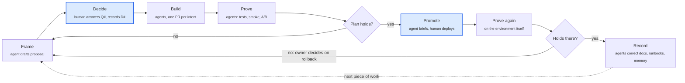

# Architect Loop

**One architect, many agents.** A set of agent skills for building real software with a single human
in charge and a rotating crew of coding agents doing most of the typing.

It was distilled from five months of building a production video platform (API, workers, ingest,
web console, iOS and Android apps, CI/CD, billing) with one engineer and Claude. Of ~200 commits,
93% were co-authored by an agent. What made it work was not how fast the agents wrote code, but how
the work was framed, decided, proven and written down.

```text
→ the human owns intent, decisions and the gates to real environments
→ agents own drafting, building, proving and recording
→ the repository is the shared brain: no chat session carries state
→ every document is a hypothesis until the environment confirms it
→ when the evidence contradicts the plan, reframe; don't push forward
```

## The loop



Blue stages belong to the human. Everything else is agent work that the human steers and reviews.
Proof runs twice: before promotion with what agents can reach, and after it on the environment
itself, which is usually the only proof that counts.

## Who owns what

```mermaid
flowchart LR
    subgraph H["Architect (human)"]
      h1[Frame: goal, constraints, order]
      h2[Decide: answers open questions]
      h3[Supply reality: devices, data, accounts]
      h4[Promote: merge, deploy]
      h5[Guard: money, identity, legal, secrets]
    end
    subgraph R["Repository (shared brain)"]
      r1[LOOP.md: the contract]
      r2[Proposals: Status, D#, Q#, G#]
      r3[Runbooks: as actually run]
      r4[Memory: dated facts]
      r5[Commit log: reasoning, retractions]
    end
    subgraph A["Agents"]
      a1[Frame: read code, draft proposal]
      a2[Build: branches, PRs]
      a3[Prove: tests, smoke, A/B, measure]
      a4[Diagnose: root cause, in writing]
      a5[Record: correct docs and memory]
    end
    H -- decisions, promotions --> R
    R -- proposals, PRs to review --> H
    A -- drafts, PRs, evidence --> R
    R -- context for every session --> A
```



## Skills

| Skill | Stage | What it does |
| --- | --- | --- |
| [`loop-init`](skills/loop-init/SKILL.md) | setup | Interviews the owner and writes `LOOP.md`: gates, environments, commands, conventions. Scaffolds `docs/proposals/`, `docs/runbooks/`. |
| [`loop-frame`](skills/loop-frame/SKILL.md) | Frame | Reads the code and the world, writes a proposal with options, a recommendation, numbered open questions and a plan whose steps each say what evidence proves them. Planning only. |
| [`loop-decide`](skills/loop-decide/SKILL.md) | Decide | Walks the owner through open questions one at a time, records numbered, dated decisions, and says which plan steps are now unblocked. |
| [`loop-build`](skills/loop-build/SKILL.md) | Build | Implements one plan step as one branch and one PR, citing the proposal section, with an outcome-sentence commit and a reasoning body. |
| [`loop-prove`](skills/loop-prove/SKILL.md) | Prove | The evidence gate, run before and after promotion and for spikes. Tests, reproducers, smoke runs, A/Bs or measurements on real data. Writes HOLDS / CONTRADICTS / UNPROVEN into the proposal; on CONTRADICTS the work goes back to Frame. |
| [`loop-promote`](skills/loop-promote/SKILL.md) | Promote | Writes the promotion brief (what changes, proof so far, risks, rollback, verify commands), stops for the human, then checks what the environment actually serves and hands the remaining claims back to Prove. |
| [`loop-record`](skills/loop-record/SKILL.md) | Record | Updates the dated Status line, writes "what shipped and where it departs", corrects disproved claims, updates runbooks and memory. |
| [`loop-reconcile`](skills/loop-reconcile/SKILL.md) | any | Audits documents against reality. Status lines go stale; this finds every claim that no longer matches the code or the environment. |
| [`loop-diagnose`](skills/loop-diagnose/SKILL.md) | Prove | Root-cause discipline: reproduce, isolate with an A/B on identical code, credit a cause only with evidence, and retract a wrong diagnosis in writing. |
| [`loop-runbook`](skills/loop-runbook/SKILL.md) | Record | Writes or corrects a runbook *as actually run*, recording each trap with the date it cost time. |
| [`loop-incident`](skills/loop-incident/SKILL.md) | any | Turns production pain into a written account, a proposal, and a fix, usually the same day. |

Each skill is self-contained: it reads the project's `LOOP.md` for local conventions. Without one,
every skill falls back to the same safe defaults: `loop-init`'s gate list, shared environments treated
as read-only-with-permission, commits only on branches. The skill then suggests `/loop-init`.

Every stage writes its output into the repository (proposal Status and Proof fields, §11 promotion
entries, PR bodies), so a fresh session can run the next stage with no chat history.

## Install

**As a Claude Code plugin** (all skills, namespaced as `/architect-loop:<skill>`):

```bash
/plugin marketplace add jugonzal/architect-loop
/plugin install architect-loop@architect-loop
```

**With [skills.sh](https://skills.sh)** (any compatible agent):

```bash
npx skills add jugonzal/architect-loop
```

**By copying** (user-wide or into one project):

```bash
./scripts/install.sh --user
./scripts/install.sh --project /path/to/project
```

Then, in a project:

```text
You:  /loop-init
You:  /loop-frame move report generation off the request path
You:  /loop-decide
You:  /loop-build step 1
You:  /loop-prove                   # before promotion: tests, smoke, A/B
You:  /loop-promote staging         # the brief: what goes out, risks, rollback
      ...you merge and deploy...
You:  /loop-promote check staging   # verifies what staging serves, hands off to prove
You:  /loop-prove                   # after promotion, on staging itself
You:  /loop-record
```

## What a project looks like

```text
LOOP.md                    the contract: gates, environments, commands, conventions
docs/
  proposals/<slug>.md      living proposals: one per initiative, updated in place
  runbooks/<topic>.md      procedures, corrected after every real run
  memory/<slug>.md         dated facts shared by every person and agent tool
```

Proposals are **living documents**, not change folders that get archived. Git history is the
archive; the document always says what is true now, with a dated Status line at the top.

## Read more

- [docs/method.md](docs/method.md): the loop, stage by stage, with the roles
- [docs/patterns.md](docs/patterns.md): the ten collaboration patterns and the evidence behind them
- [docs/failure-modes.md](docs/failure-modes.md): what went wrong and the guardrail each failure produced
- [docs/adopting.md](docs/adopting.md): a checklist for a new or existing project
- [docs/openspec-comparison.md](docs/openspec-comparison.md): what this borrows from OpenSpec, and where it differs

## License

[MIT](LICENSE)
