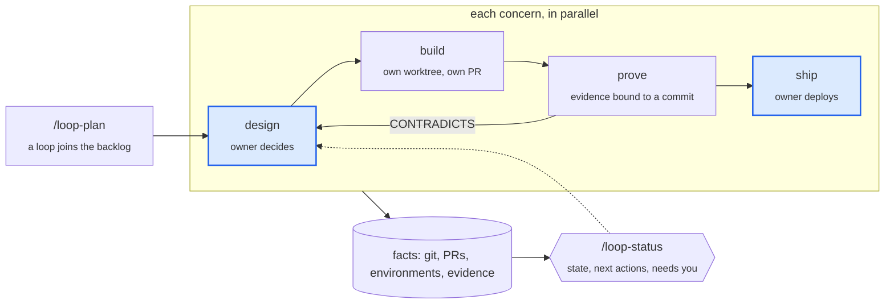

# Architect Loop

**One architect, many agents.** A set of agent skills for building real software with a single human
in charge and a crew of coding agents doing most of the typing, several of them at once.

It was distilled from five months of building a production video platform (API, workers, ingest,
web console, iOS and Android apps, CI/CD, billing) with one engineer and Claude. Of ~200 commits,
93% were co-authored by an agent. What made it work was not how fast the agents wrote code, but how
the work was framed, decided, proven and written down. Generation 2 keeps all of that, and changes
where state lives, so that many agents can work in parallel and nobody has to ask whether something is done.

```text
→ the human owns intent, decisions and the gates to real environments
→ agents own planning drafts, building, proving and recording, each concern in its own worktree
→ the repository is the shared brain: no chat session carries state
→ status is computed from facts, never written down
→ every document is a hypothesis until the environment confirms it
```

## Learn it in one minute

```text
One file:    a concern = done when + needs + touches + effects + ships-to
Five verbs:  plan a loop; then design → build → prove → ship each concern, in parallel with the others
One habit:   /loop-status tells you what is true and what to run next
```

A **loop** is a goal the system should move toward, such as "move report generation off the request path".
Several loops can be tracked at once, and most of them wait in a backlog. A loop is made of **concerns**:
independent outcomes, each a small file with a contract. Each concern goes through its own design, build,
prove and ship, on its own branch, in its own worktree, so separate agents can work on separate concerns
at the same time.



Blue stages need the human: design is where the owner gets grilled on decisions, and shipping is the
owner's act. A failed proof sends that one concern back to design, and the others carry on.

## A concern

```markdown
---
needs: [job-contract]
touches: [api/reports/queue*, db/migrations/*report*]
effects: [migration on shared data]
ships-to: production
---
# Report jobs survive a worker restart

## Done when
- **C1** A job enqueued before the worker is killed completes after it restarts. Prove: kill -9 on staging.
```

There is no status field. `/loop-status` works out whether this concern is open, ready, building, merged,
shipped, stale or done from facts: its branch and pull request, whether its commits are on `main`, whether
the target environment serves them, and evidence lines like this one, which always cite a commit:

```text
- 2026-10-21 · C1 · HOLDS · rung 1 · staging @9f3c2e1 · 3 real restarts during the deploy, 0 jobs lost
```

## Skills

| Skill | What it does |
| --- | --- |
| [`loop-status`](plugin/skills/loop-status/SKILL.md) | **Start here, any time.** Derives every concern's state from facts, shows what needs the owner and what agents can start now, flags drift, and records Shipped notes and corrections on the owner's yes. |
| [`loop-plan`](plugin/skills/loop-plan/SKILL.md) | Adds a loop to the backlog: intent, goals, a first cut of independent concerns, and its relations to the loops already tracked, at the loosest coupling that works. Quick, so a new idea never derails the current loop. |
| [`loop-design`](plugin/skills/loop-design/SKILL.md) | Works out how a loop or a concern will be built by grilling the owner on open decisions and on constraints found in the code. Records decisions, and reshapes concerns so they can be built in parallel. |
| [`loop-build`](plugin/skills/loop-build/SKILL.md) | Builds one concern in its own worktree and branch, as one PR, inside the paths its contract allows. `--ready` builds every ready concern at once, one agent each. |
| [`loop-prove`](plugin/skills/loop-prove/SKILL.md) | The evidence gate: tests, smoke runs, A/Bs, measurements on real environments. Writes HOLDS / CONTRADICTS / UNPROVEN bound to a commit and an environment. Runs spikes. |
| [`loop-ship`](plugin/skills/loop-ship/SKILL.md) | Writes the brief for a deploy (what goes out, declared effects as manual steps, risks, rollback), stops for the owner, then checks what the environment actually serves. |
| [`loop-init`](plugin/skills/loop-init/SKILL.md) | Writes `LOOP.md`, the contract: gates, environments and how each reports the commit it serves, commands, conventions. Upgrades generation 1 projects. |
| [`loop-diagnose`](plugin/skills/loop-diagnose/SKILL.md) | Root-cause discipline: reproduce, isolate with an A/B on identical code, credit a cause only with evidence, retract wrong diagnoses in writing. |
| [`loop-runbook`](plugin/skills/loop-runbook/SKILL.md) | Writes or corrects a runbook *as actually run*, recording each trap with the date it cost time. |
| [`loop-incident`](plugin/skills/loop-incident/SKILL.md) | Turns production pain into a written account, a loop of concerns, and a fix, usually the same day. |

Each skill is self-contained and reads the project's `LOOP.md` for local conventions. Without one, every skill
falls back to safe defaults (the gates in `loop-init`, shared environments read-only with permission, nothing
merged by agents) and suggests `/loop-init`.

## Who holds what

| | Holds | Never |
| --- | --- | --- |
| **The architect** (one human) | Intent, priorities, decisions, merging code, shipping, and the gates: money, identity, legal, secrets, production data | Types most of the code |
| **Agents** (many, short-lived, often in parallel) | Drafting plans and designs, building, proving, diagnosing, recording | Merges code, deploys, or decides a gated question |
| **The repository** | `LOOP.md`, loops and concerns, runbooks, memory, the commit log | Relies on a chat session to hold state |

One standing permission makes the loop fast without making it risky: agents may merge pull requests that change
only `docs/loops/`, as long as every commit their evidence cites is already on `main`. Code and loop documents
never share a pull request, so a loop document can never describe work that is still on a branch.
[`check_loop_pr.sh`](plugin/skills/loop-status/scripts/check_loop_pr.sh) checks that before every such merge. The owner
can revoke it in `LOOP.md` §2.1.

## Install

**As a Claude Code plugin** (all skills, namespaced as `/architect-loop:<skill>`):

```bash
/plugin marketplace add jugonzal/architect-loop
/plugin install architect-loop@architect-loop
```

**With [skills.sh](https://skills.sh)** (any compatible agent):

```bash
npx skills add jugonzal/architect-loop
```

**By copying** (user-wide or into one project):

```bash
./scripts/install.sh --user
./scripts/install.sh --project /path/to/project
```

Every route installs only [`plugin/`](plugin): the skills and the plugin manifest. The rest of this repository
(the method docs, the tests, and the command center that is being built here) never ships, and nothing in
`plugin/` depends on it, so the loop always runs from a terminal alone. `scripts/check.sh` enforces that.

Then, in a project:

```text
You:  /loop-init
You:  /loop-plan move report generation off the request path
You:  /loop-design report-pipeline          # you get grilled; concerns become ready
You:  /loop-build report-pipeline --ready   # one agent and one worktree per ready concern
      ...you review and merge the PRs...
You:  /loop-ship staging                    # the brief; you deploy; it verifies
You:  /loop-prove report-pipeline/queue staging
You:  /loop-status                          # what is true, what needs you, what agents can start
```

## Upgrading from generation 1

If your project has `docs/proposals/` with Status lines and numbered steps, reinstall the skills and run
`/loop-init`. It runs [`migrate_gen1.py`](plugin/skills/loop-init/scripts/migrate_gen1.py) as a dry run, shows you what
becomes a loop and what stays as history, and applies it on your yes. See [docs/upgrading.md](docs/upgrading.md).

## What a project looks like

```text
LOOP.md                          the contract: gates, environments, commands, conventions
docs/
  loops/<loop>/README.md         a loop: intent, goals, relations, shared decisions
  loops/<loop>/<concern>.md      a concern: contract, design, decisions, evidence
  proposals/                     for people: free-form proposals, abandoned loops (not tracked)
  runbooks/<topic>.md            procedures, corrected after every real run
  memory/<slug>.md               dated facts shared by every person and agent tool
```

## Read more

- [docs/method.md](docs/method.md): the seven principles, and how the loop works
- [docs/patterns.md](docs/patterns.md): the ten collaboration patterns and the evidence behind them
- [docs/failure-modes.md](docs/failure-modes.md): what went wrong, and the structure or guardrail each failure produced
- [docs/adopting.md](docs/adopting.md): a checklist for a new or existing project
- [docs/upgrading.md](docs/upgrading.md): moving a generation 1 project to generation 2
- [docs/openspec-comparison.md](docs/openspec-comparison.md): what this borrows from OpenSpec, and where it differs
- [docs/proposals/concerns-as-functions.md](docs/proposals/concerns-as-functions.md): the proposal behind generation 2

## License

[MIT](LICENSE)
