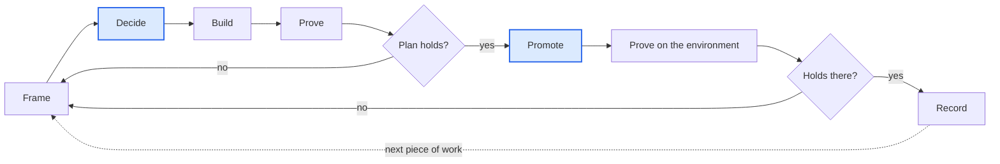

# The method

One loop, run at every scale from a one-line fix to a quarter's milestone:

**Frame → Decide → Build → Prove → Promote → Record**, with an evidence gate that runs twice, once
before promotion and again on the environment afterwards, and sends work back to Frame when the plan
turns out to be wrong.

## Three owners

| Owner | Holds | Never |
| --- | --- | --- |
| **The architect** (one human) | Intent, priority, decisions, promotion, and the gates: money, identity, legal, secrets, production data | Types most of the code |
| **Agents** (many, short-lived) | Drafting, building, proving, diagnosing, recording | Merges, deploys, or decides a gated question |
| **The repository** | Everything both must remember: `LOOP.md`, proposals, runbooks, memory, the commit log | Relies on a chat session to hold state |

The human and the agents rarely hand work to each other directly. They hand it through the
repository, which is why a fresh agent session can pick up a half-finished milestone.

## The stages

| Stage | Human | Agent | Artifact left behind | Skill |
| --- | --- | --- | --- | --- |
| Frame | Goal, constraints, priority | Reads code and environment, drafts proposal with options | `docs/proposals/<slug>.md` | `loop-frame` |
| Decide | Answers questions, picks option | Lays out trade-offs, recommends, records | `D#` rows, updated plan | `loop-decide` |
| Build | Chooses scope per PR | Code, tests, docs, commit narrative | One PR per intent | `loop-build` |
| Prove | Supplies reality: devices, data, accounts | Reproducers, smoke runs, A/Bs, measurements; runs spikes | Verdict in the step's Proof field and the PR | `loop-prove`, `loop-diagnose` |
| Promote | Merges, deploys, signs off | Brief before, verification after | Dated entry in proposal §11 | `loop-promote` |
| Record | Reviews corrections | Status lines, departures, runbooks, memory | Corrected docs, memory | `loop-record`, `loop-runbook` |

`loop-reconcile` and `loop-incident` run at any point: the first when documents may have drifted from
reality, the second when reality has made itself felt.

## Why each stage exists

**Frame** exists because agents build confidently on whatever premise they are given. Writing
"where we actually are" from the code and the environment, not from the docs, is where most wrong
premises are caught. Options and a recommendation make the owner's decision cheap.

**Decide** exists because decisions made in chat evaporate. A numbered, dated decision can be cited
by a PR six weeks later, and overturned explicitly rather than drifted away from.

**Build** is deliberately narrow: one intent per branch, a subject line that reads as an outcome,
and a body that carries the reasoning. The commit log becomes a changelog and a lab notebook at once.

**Prove** is the stage most teams skip with agents, and the one that pays most. "The tests pass"
is the weakest acceptable rung; the strongest is the real environment with real input, which agents
usually reach only after the owner promotes, so Prove runs again then. A proof that contradicts the
plan is a success: it sends the work back to Frame before more is built on sand.

**Promote** stays human because it is where irreversibility lives: data, money, users, reputation.
Keeping it human also keeps the human's picture of the system current.

**Record** exists because the next agent starts from zero. Status lines, departures from the plan,
corrected claims, runbook traps and memory are how a project with no long-lived agent still learns.

## Scale

The loop is fractal. A milestone is one loop whose Build stage contains many smaller loops. A
one-line fix may collapse Frame and Decide into a sentence in chat, but it still gets proven,
promoted by the owner, and recorded if it taught anyone anything.

## Parallelism

Independent Build and Prove work runs in parallel: separate worktrees or sessions, each on its own
branch, each citing the same proposal. The proposal is the coordination point; merge order is the
owner's call. Framing, deciding and promoting stay serial because they are where the one human's
attention is the constraint.

## Choosing models

Match the model to the depth of reasoning, not the size of the diff. Fast models are fine for
scaffolding and mechanical edits; the strongest available model earns its cost on framing,
evaluations with competing options, and diagnosis where a plausible wrong answer is expensive.
