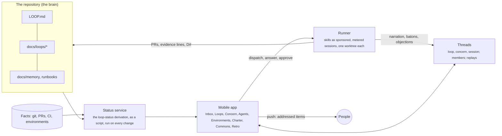

# Proposal: A command center for loops, shared by people and agents

**Status:** Proposed, 2026-10-19. Written from a read of every skill in `skills/` at `3fdc759` and of
*The Second Toolchain* (second draft, "Tools as Media, Media as Habit").
**Area:** a new mobile application, plus the small changes to `LOOP.md`, the concern format and the skills that
it needs (§8). Nothing here changes how a loop runs from a terminal.

## 0. Summary

The architect loop works today as a set of skills driven by one person from one terminal. In practice each loop
is a conversation that lives for weeks, overlaps other loops on the calendar, and needs more than one person to
push it forward: someone owns the decisions, someone else holds a gate, a third person has the device a proof
needs. The terminal cannot show that. It shows one session at a time, and what the session knew is gone when
it closes.

*The Second Toolchain* argues that a tool is a medium: its deepest effect is the habit its form makes easy. Its
diagnosis of the chat box (private context, unread transcripts, blurred authorship, unearned trust) describes
exactly what a terminal-driven loop loses when a second person joins. Its thirteen media are the cure, and the
useful surprise is that the loop already implements seven of them in the repository (§1). What is missing is a
surface where several people see the same facts, answer what is addressed to them, join an agent's work
mid-way, and hand work to each other without re-explaining it.

**Recommendation:** build the command center as a thin, thread-first mobile app over three things: a status
service that computes every loop's state from facts the way `/loop-status` does; a runner that starts skills as
sponsored, metered sessions; and threads that keep the conversation around each loop and concern. The app
stores no status and decides nothing. The repository stays the shared brain. Every decision, verdict and
record still lands in `docs/loops/` through the existing skills, and a person who never opens the app loses
nothing.

In one line: *the repository holds what is true, the app holds who is talking about it and who it is waiting on.*

## 1. Where we are: the loop, read as media

The second toolchain names thirteen media. Read the loop's skills and formats against them and most are
already there, as files rather than screens. That matters, because the app's job is to surface them, not to
invent them.

| Medium (its message) | Where the loop already has it | What the app would add |
| --- | --- | --- |
| **Intent Ledger** (say what you want before anyone builds it) | A loop's `G#` and a concern's Done when (`C#`), each with how and where it is proven. `loop-build` refuses a concern that is not `ready` | A place to read and answer the questions that make a concern ready, from a phone |
| **Charter** (how we work is written down) | `LOOP.md`: gates, delegations, environments, conventions, traps | A readable Charter with named gate holders, and an amend-or-override path when an agent cites it |
| **Why-Record** (the reason outlives the decision) | `D#` rows with who, when, the `Q#` closed and what was superseded; "agent, delegated by owner" | Decision cards that keep the options and the recommendation beside the answer |
| **Evidence Gate** (done is a claim; show me) | `loop-prove`: HOLDS, CONTRADICTS, UNPROVEN, bound to a commit, an environment and a rung. `loop-status` calls nothing done without a current HOLDS | Evidence shown before the diff; a way for a person to supply the proof only they can obtain |
| **Small Step** (the unit of work is the unit of review) | One concern, one branch, one PR, at most three claims, no "and" in the title | Size and claim count beside each PR; decomposition proposals as cards |
| **Baton** (work is always in someone's hands) | The concern file plus the PR body's "Still to prove" is the handoff; the Shipped note is the last baton | A visible chain of handoffs per concern, and an acknowledgement before the next session acts |
| **Context Commons** (what the team knows, someone tends) | `docs/memory/` with `verified` dates; runbooks with "Last run as written"; `/loop-status audit` | Stewards, freshness flags, and agent-proposed corrections awaiting a person |
| **Objection Register** (disagreement is a deliverable) | Partly: CONTRADICTS, `loop-build`'s stop conditions, "contradicts `<loop>/D2`" escalation, drift | A structured objection with type and confidence, and an acknowledgement with a reason |
| **Cross-Review** (nobody's work goes unread) | One direction only: the owner reviews agent PRs | Agents reviewing human PRs against the same Done when, and comments that must be answered |
| **Open Workbench** (working with an agent is team work) | The repository and its PRs, but the design conversations happen in a private terminal and leave only their output | Threads: one per loop, one per concern, one per session, readable and joinable by the team |
| **Roster** (every hand has a name, every agent a sponsor) | `Decided by`, the `Concern:` trailer, `Co-authored-by` | Agent identity with scope and sponsor on every session, PR and evidence line |
| **Meter** (agent work has a cost) | Nothing | Cost and duration beside each session and each loop |
| **Replay** (nothing that happened is unwatchable) | Nothing: the transcript is discarded | Session transcripts kept as linkable replays, cited from PRs and evidence |

The right-hand column is the feature list in miniature. §5 expands it skill by skill.

## 2. Principles for the command center

Each one is a principle from the second toolchain applied to the loop's existing structure. Where the two
disagree, the loop's seventh principle wins: prefer structure to discipline.

1. **The repository stays the brain.** The app writes no status, no decision and no evidence of its own. It
   renders what the status service computes from git, pull requests, environments and evidence lines, and when a
   person acts in the app, the action runs a skill that writes to the repository the way it does today. Two
   people looking at the app see the same facts because there is only one source of them. *(P4: compute status;
   Charter: the agents hold us to what is written.)*

2. **The unit is the thread, and threads have members.** A loop has a long-lived thread. A concern has a thread
   for its lifetime. An agent session is a thread inside its concern. Each has a URL, a subject, a member list and
   a place in the loop's history. Anyone on the loop can read, join mid-way, and redirect. *(Open Workbench.)*

3. **Everything is addressed to someone.** An item in the queue names the person it waits on: the loop owner
   for a decision, the gate holder for a gate, whoever has the device for a proof. Nothing is addressed to
   "everyone", because an item for everyone is an item for no one. *(Baton; Roster.)*

4. **Cards are cool, not hot.** A question card shows the options, the recommendation, why it matters now and what
   it blocks, and leaves the answer to the person. A review card shows the evidence first and the diff second. A
   finished PR is never presented as a verdict to rubber-stamp. *(Cool, not hot; Evidence Gate.)*

5. **Every agent has a sponsor and a meter.** A session started from the app runs under the name of the person
   who started it, inside the scope its skill allows, with its cost visible while it runs. *(Roster; Meter.)*

6. **The phone is for deciding, reading, redirecting and supplying reality.** It is not for typing code. Anything
   larger than a decision opens a session an agent runs, or a desktop. *(Small Step; the grain of attention.)*

7. **Design for the reversal.** Each feature group in §5 names what it turns into when pushed too far, and the
   guard. Most guards are Charter clauses, which means `LOOP.md` gains a short §8 (§8 of this proposal).

## 3. Who does what when there are many people

Generation 2 says "one architect". The command center keeps that at the level where it is true, which is the
loop, and lets many loops have many architects.

| Role | Holds | Recorded where |
| --- | --- | --- |
| **Loop owner** (one person per loop) | Decisions for that loop, merging its code PRs, shipping its concerns, its "Needs you" queue | `owner:` in the loop README's front matter |
| **Gate holder** (one person per gate) | A gate from `LOOP.md` §2: money, identity, secrets, production data, legal text, DNS. Several loops cross the same gate; the same person answers for it each time | A name beside each gate in `LOOP.md` §2 |
| **Contributor** | May dispatch agents on the loop, review PRs, answer questions the owner delegates to them, supply reality (a device, a dataset, an account) | Named in the loop README's `members:`; a delegated answer is recorded `<name>, delegated by <owner>, date` |
| **Sponsor** | The person who started an agent session. Answers for what it did; is the name in an incident review | On every session, PR body and evidence line the session produces (§8) |
| **Observer** | Reads everything on a loop, decides nothing | Membership of the thread |

Three consequences the app has to carry:

- **Decisions stay single-writer.** Two contributors cannot both answer `Q3`. The first answer records `D4`; a
  second opinion becomes a comment on the decision, and if it wins, a superseding `D5`. The format already works
  this way, so the app only has to show who is answering now (presence) to make a collision rare.
- **Humans hand off like agents do.** When a loop owner goes on leave, the baton is a `D#` in the README naming
  the new owner and the date. The app shows the chain, so "who owns this now?" has a visible answer.
- **Gates travel with the person, not the loop.** A concern whose `effects` include "migration on shared data"
  puts a card in the gate holder's queue, not the loop owner's, even when they are different people.

## 4. The app, screen by screen

Each screen is described by what it shows and by the message its form carries, in the sense the second toolchain
gives that word.

### 4.1 Inbox: "Needs you"

The home screen, and the only one most people open on most days. Every item across every loop that waits on
*this* person, sorted the way `/loop-status` sorts it: by how many concerns it unblocks. Each item is a card of
one of eight kinds, and each card can be finished from the phone:

| Card | Comes from | What the person does | What runs |
| --- | --- | --- | --- |
| Question | An open `Q#` that blocks a claim | Picks an option, or types another, with an optional reason | `/loop-design` records the `D#` |
| Review | A PR with CI green and proof in its body | Reads evidence, then the diff; answers comments; merges or sends back | The forge's merge; an agent reply |
| Ship | Merged concerns the environment does not serve | Reads the brief and the manual steps; says "deployed" | `/loop-ship` verifies the served commit |
| Supply reality | An UNPROVEN claim that needs a device, an account or a production read | Attaches a screenshot, a number, a photo, or a line of output | `/loop-prove` records the evidence line |
| Objection | An agent objected above the threshold (§5.5) | Acknowledges with a reason, or changes the plan | The reason is recorded with the objection |
| Contradiction | A CONTRADICTS on a shared environment | Chooses redesign or rollback | `/loop-design` or the rollback runbook |
| Record | Shipped notes, corrections, memory facts the status run proposes | Approves or edits | `/loop-status`'s record step |
| Drift | A document the facts contradict | Confirms the correction | The record step |

*Message:* you are the constraint, and here is exactly what waits on you, smallest first.

### 4.2 Loops

Active loops first, each as a row of its concerns in their ten states, then the backlog one line each, then
parked. A loop opens to its goals with their verdicts, its relations to other loops as a small graph, its shared
decisions, its questions, and its thread. The backlog is visible but quiet, so a new idea planned from the phone
(`/loop-plan`, a one-paragraph form) never takes focus from the active work.

*Message:* several things are moving at once, and you can see all of them without being responsible for all of them.

### 4.3 Concern

The concern file, rendered: the contract (`needs`, `touches`, `effects`, `ships-to`) as chips; Done when with a
verdict beside each claim (`HOLDS · rung 1 · staging @9f3c2e1`); the derived state and the fact that produced it
("building: PR #46 is open, nothing on main yet"); the thread; the sessions that touched it with their sponsor
and cost; the chain of batons; the evidence timeline. The "why" of the state is always one tap away, because a
state nobody can explain is a status line in disguise.

*Message:* this is what is true about this piece of work, and here is how we know.

### 4.4 Threads

A loop thread, a concern thread, and a session thread per agent run. Agents narrate to the thread in language
addressed to the team. A person can post, mention an agent to dispatch a skill ("@prove this on staging"), or
join a running session to redirect it. Posting a decision in a thread is not recording it: the app offers to
record it, and `/loop-design` writes the `D#`. Drafts are private until posted.

*Message:* working with an agent is team work, and the trail is here.

### 4.5 Agents (the Roster)

Who is running, on which concern, in which worktree, since when, at what cost, with what estimate, sponsored by
whom. Pending objections. A tap opens the session thread; another stops the session, which writes its baton
first. Idle agents are the catalogue of skills, each with its scope and what it may never do, taken from
`LOOP.md`.

*Message:* every hand that touches the code has a name, and every agent has a person who answers for it.

### 4.6 Environments

One row per environment from `LOOP.md` §3: the commit it serves, read moments ago, the concerns merged but not
yet served, and a Ship button that produces the brief. "Unknown" is shown as unknown when the served-commit
command fails, never filled in from memory.

*Message:* shipped and done are different, and this is where the difference lives.

### 4.7 Charter

`LOOP.md`, readable, with the gate holders' names, the delegations with who granted them and when, and the
project traps. When an agent cites a clause in a thread, the citation links here. A person who disagrees gets
two buttons: propose an amendment (a PR on `LOOP.md`) or override once with a recorded reason, and the first is
only slightly harder than the second.

*Message:* how we work is written down, and amending it is cheaper than arguing.

### 4.8 Commons

Memory facts and runbooks with their freshness: `verified` and "Last run as written" dates, flagged past a
Charter-defined age. Each has a steward. Corrections that agents proposed from a status run wait here for a
steward's yes. A gardening rotation shows who walks which section this week.

*Message:* what the team knows belongs to the team, and someone tends it.

### 4.9 Retro

Per loop, never per person: agent spend over time, review volume, objections raised and overruled and which of
the overruled ones a later CONTRADICTS vindicated, the Commons' staleness ratio, the number of "Correct …"
commits. This is the toolchain's "habit of examining the toolchain", rendered.

*Message:* the tools are shaping us; look up now and then and check how.

## 5. Feature catalogue: skills, features, and the behaviour each one promotes

One table per skill. "Medium" names the second-toolchain medium whose habit the feature carries. "Reverses
into" and "Guard" follow the document's fourth law. Features marked **new** need a change to a skill or a format
(§8); everything else reads what the skills already write.

### 5.1 `loop-status` → the Inbox, the Loops board, the Concern page

| Feature | What a person sees or does | Medium and habit | Reverses into | Guard |
| --- | --- | --- | --- | --- |
| Derived state per concern, with the fact behind it | The ten states as a strip; tap for "building because PR #46 is open" | Evidence Gate: a state is a claim with a receipt | A status line in a nicer font | The app caches a derivation keyed by the commits it read; it never stores a state a person typed |
| "Needs you", addressed and sorted by unblocking | The Inbox (§4.1) | Baton: work is in someone's hands, and they know | An interruption machine | Push only for blocking items; everything else in a digest the person schedules; quiet hours per person |
| "Agents can start now" as one-tap dispatch | Ready concerns, stale proofs, incomplete contracts, each with a Start button | Open Workbench: anyone can push the loop | Thrash: everyone starts everything | Sponsor cap per person; a budget that triggers a conversation, not a shutdown |
| Drift cards | A document claim the facts contradict, with the command that checked it | Context Commons: staleness has an owner | Nagging | Drift is shown on the loop, not pushed, until it blocks something |
| Record cards (Shipped notes, corrections, memory) | Approve or edit, from the phone | Why-Record: the lesson is written where the next session looks | Justification theatre | The card shows what no command could have re-observed; the rest is not offered |
| Audit on demand | Runs `/loop-status audit` on a folder; findings become correction cards | Context Commons | Audit fatigue | Scheduled gardening (§5.11), not on every open |
| Loop relations graph | Relates / needs a decision / needs a concern, across loops | Intent Ledger: coupling is declared | Diagram nobody reads | Shown on the loop page only when a relation exists |
| Presence | Who is looking at this question or concern right now | Open Workbench | Surveillance | Presence is on the item, not on the person; there is no "what is X doing" view |

### 5.2 `loop-plan` → the backlog

| Feature | What a person sees or does | Medium and habit | Reverses into | Guard |
| --- | --- | --- | --- | --- |
| Plan from the phone | A one-paragraph intent form: what changes, for whom, why now; the agent drafts goals, concerns and relations | Intent Ledger: say what you want first; agents draft, humans approve | Waterfall | Three lines is a valid loop; provisional concerns are normal |
| Overlap warning | "This overlaps `billing`'s active concerns on `api/reports/`" before the loop is saved | Small Step; Intent Ledger | Blocking on hypotheticals | A warning, never a block; relations are recorded at the loosest coupling |
| Backlog view | One line per loop, quiet | Open Workbench: visible, not loud | The backlog as a guilt list | Backlog loops carry no notifications |

### 5.3 `loop-design` → Question cards and the concern thread

| Feature | What a person sees or does | Medium and habit | Reverses into | Guard |
| --- | --- | --- | --- | --- |
| Question card | One question, why it matters now, two to four options with consequences, a recommendation, what it blocks, the default if unanswered | Cool, not hot: the person completes the work; Why-Record | Rubber-stamping the recommendation | The tap records *who* decided; the recommendation is never pre-selected; gated questions require a typed reason |
| Delegated answers | The owner forwards a question to a contributor | Roster: authorship is never anonymous | Decisions diffusing | Recorded `<name>, delegated by <owner>, date`; gated questions cannot be delegated |
| Decisions in passing | A thread message that looks like a decision gets a "record this?" offer | Why-Record: captured at the moment of decision | Agents interrogating trivialities | Offered once per message; "no, just talking" is remembered for the thread |
| Supersede, never edit | A second answer to a settled question opens a supersession, showing what relied on the old decision | Why-Record; P3 immutability | Decision churn | The card lists every concern that would go stale |
| New constraints from code | "Design found that X is not what the loop assumed" as a confirmation card | Evidence over assertion | Noise | Only constraints that change a contract reach the Inbox |
| Parallel design sessions | Several concerns designed at once; their questions pool in the Inbox | Open Workbench; Small Step | A wall of questions | Sorted by unblocking; the owner answers in one sitting |

### 5.4 `loop-build` → the Agents screen and Review cards

| Feature | What a person sees or does | Medium and habit | Reverses into | Guard |
| --- | --- | --- | --- | --- |
| Start a build from the phone | Tap on a ready concern; a sponsored session starts in its own worktree | Roster; Small Step | Everyone dispatching everything | Sponsor cap; one session per concern (the open PR is the claim) |
| Live session thread | The agent narrates to the team; a person can join and redirect | Open Workbench; cool medium | Noise | Narration is collapsed by default; the thread shows milestones (PR opened, tests green, stopped at a gate) |
| Stop conditions as cards | "Needs a path outside `touches`", "needs an unrecorded decision", "would cross a gate", "the code contradicts Where we are" | Objection Register: the agent objects in a known shape | Agents refusing to act | Each card offers the next command (`/loop-design` to widen, a `D#`, a gate decision) |
| Review card, evidence first | The PR body's proof lines, then effects and rollback, then the diff, then the comments | Evidence Gate: review evidence before code | Proof theatre | Rung is shown; rung 6 is never green; evidence types are named by Done when, not chosen by the builder |
| Size beside the PR | Files, lines, claims; a soft limit with a justification field | Small Step | Fragmentation | The Charter names legitimately large classes (migrations, dependency upgrades) |
| Comments must be answered **(new)** | A PR cannot be merged from the app while a comment has no reply; the agent's reply is "agreed, changed", "disagreed, because" or "out of scope, question opened" | Cross-Review: never silence | Review fatigue | Comment budget per review, ranked; the Charter names what may be resolved without discussion |
| Agents review human PRs **(new)** | A human-authored PR gets a review against the same Done when and `LOOP.md` | Cross-Review: symmetric | Bot noise | Same budget and ranking as above |
| Baton on stop **(new)** | A stopped or finished session leaves a short note: done, not done, tried, risky, next; the next session acknowledges it before acting | Baton | Ritual overhead | Required only at session end and thread close; hard length cap; a blank field means ask |

### 5.5 `loop-prove` → Supply-reality cards and verdict chips

| Feature | What a person sees or does | Medium and habit | Reverses into | Guard |
| --- | --- | --- | --- | --- |
| Verdict chips on every claim | HOLDS / CONTRADICTS / UNPROVEN with rung, environment and commit | Evidence Gate: evidence is a value bound to its inputs | Green badges nobody reads | Stale is its own colour; a chip always carries its commit |
| Supply reality | The person with the device attaches a photo, a screenshot or a number; the skill writes the evidence line citing the served commit | Evidence Gate: the owner supplies what only they can | Screenshots of the wrong thing | The card names the claim, the environment and the served commit the evidence must be for |
| Spike from a question | "Would an experiment answer this?" on a Question card starts `/loop-prove Q<n>` | Measure or spike before committing | Experiments instead of decisions | The question stays open and visible until the spike answers it |
| Contradiction card | The claim, the design text it contradicts, whether users are affected, the rollback option | Objection Register; failure is local | Panic | Only that concern stops; siblings carry on and the card says so |
| Objections with confidence **(new)** | An agent registers uncertain / disagree / risky / out-of-scope, with confidence and an alternative; above a threshold it blocks until acknowledged | Objection Register: disagreement is a deliverable | Alarm fatigue | Thresholds tuned in Retro by vindication rate; objection budget per task |
| Re-prove on stale | A stale concern offers one-tap re-prove on the environment that serves it now | Evidence Gate | Proof churn | Stale is computed from `touches` and `needs`, never from time alone |

### 5.6 `loop-ship` → the Environments screen and Ship cards

| Feature | What a person sees or does | Medium and habit | Reverses into | Guard |
| --- | --- | --- | --- | --- |
| Ship brief as a card | What goes out, proof so far, manual steps from declared `effects` in order, risks, rollback, verify commands | Evidence Gate; effects at the edges | A deploy checklist nobody reads | UNPROVEN claims and undeclared effects are shown as blockers, not footnotes |
| Gate holder routing | A manual step on a gate goes to the gate holder's Inbox | Roster: gates travel with the person | Diffusion | One name per gate in the Charter |
| "I deployed" | The person taps; verification runs; the served commit and the verify outputs come back as a card | Evidence over assertion: a deploy that succeeded is not a claim that holds | Trusting the tap | Verification reads the environment; a mismatch is a Contradiction card |
| Unowned commits | Commits in the batch that belong to no concern | Intent Ledger: an uncited change is suspicious | Bureaucracy | Shown, never blocked; the Charter can make it block for production only |

### 5.7 `loop-init` → the Charter screen

| Feature | What a person sees or does | Medium and habit | Reverses into | Guard |
| --- | --- | --- | --- | --- |
| Charter, readable | Gates with holders, delegations with grantor and date, environments, commands, traps | Charter: how we work is written down | A legal code | A length budget and a quarterly prune, both in the Charter |
| Amend or override | Two buttons when an agent cites a clause the person disagrees with | Charter: amend rather than override | Rule-lawyering | Agents may cite, never block, on what the Charter does not forbid; "when silent, ask" |
| Gate holders **(new)** | A name beside each gate | Roster | Rubber-stamp holders | A mandatory inspection cadence is visible in Retro |
| Drift between Charter and code | A served-commit command that stopped working, a deploy script changed in a batch | Charter drift detection | Noise | Shown on the Charter page; pushed only when it blocks a ship |

### 5.8 `loop-diagnose` → the incident room and Contradiction cards

| Feature | What a person sees or does | Medium and habit | Reverses into | Guard |
| --- | --- | --- | --- | --- |
| Hypotheses as a card | H1, H2, each with the prediction that would split them, and the A/B proposed | Evidence over assertion; root cause stated in the open | Analysis paralysis | The cheapest discriminating test is offered first |
| Retraction as a first-class message | "Correct the root cause: X, not Y" appears in the thread and the commit | Why-Record: the reason outlives the decision, and so does its correction | Shame | Blameless tone is a Charter clause; the subject is the system |
| Replay link **(new)** | The session that found the cause is linkable from the evidence line | Replay: debug by replaying first | Surveillance | Charter: replays are for debugging and learning, never for evaluation |

### 5.9 `loop-runbook` → the Commons

| Feature | What a person sees or does | Medium and habit | Reverses into | Guard |
| --- | --- | --- | --- | --- |
| Runbook with freshness | "Last run as written" and the status draft / run | Context Commons: freshness has an owner | Unowned wiki | Each runbook has a steward |
| Correct after a run | After a Ship card completes, the app offers "correct the runbook against what you just did" | Reality corrects the document | Ritual | Offered once, with the diff of what differed |
| Traps as cards | A dated trap added from the phone in two lines | Why-Record | Trivia | The trap must name what it cost |

### 5.10 `loop-incident` → the incident room

| Feature | What a person sees or does | Medium and habit | Reverses into | Guard |
| --- | --- | --- | --- | --- |
| Incident room | A thread with the timeline (observed vs inferred), belief-vs-truth table, weak assumptions `A#`, proposed changes `P#` | Open Workbench during the worst hour; Objection Register after it | Panopticon of the outage | Members are whoever is on call plus the loop owners touched; the room closes into a loop |
| Mitigation cards | The fastest safe mitigation and its side effects, for the person with the gate | Charter: effects belong to people | Agents mitigating | Read-only investigation; mitigations are the gate holder's, unless §2.1 delegates the exact action |
| Close into a loop | The `P#`s become concerns via `/loop-plan`; the cost is recorded in the README | Incident → loop → fix, in one day | Postmortems nobody acts on | The new loop's concerns appear on the board the same day |

### 5.11 What the toolchain asks for that no skill covers yet

These are features the app needs for the second toolchain's messages to be heard, and each needs a small
addition to the skills or the formats (§8).

| Feature | Medium | What it needs |
| --- | --- | --- |
| Agent identity and sponsor on every artifact | Roster | A `Sponsored-by:` trailer beside `Concern:`; the runner sets it |
| Cost and duration per session, per concern, per loop | Meter | The runner reports tokens, tool calls, wall-clock and money; skills state an estimate before substantial work |
| Session replays, linkable from PR bodies and evidence lines | Replay | The runner keeps transcripts; a `session:` field on evidence lines and PR bodies (optional) |
| Batons with acknowledgement | Baton | A fixed short form the runner writes at session end and reads at session start |
| Objections with type and confidence | Objection Register | A schema for `loop-build`, `loop-prove` and `loop-design` to emit, and a threshold in `LOOP.md` |
| Comments that must be answered, and agents reviewing humans | Cross-Review | A review mode for `loop-prove` or a small `loop-review` skill, with a comment budget |
| Stewards and gardening | Context Commons | A `steward:` field on memory facts and runbooks; a rotation in `LOOP.md` |
| Retro over overruled objections, spend and staleness | The habit of examining the toolchain | Nothing new in the repository; the app computes it from sessions and evidence |

## 6. Architecture, briefly

- **Status service.** The derivation table in `loop-status` becomes a script (the proposal behind generation 2
  called this option C and deferred it). A UI needs status that is deterministic, cheap and fresh, and the
  table is precise enough to implement. It runs on every push, PR event and environment poll, and the app
  shows the commits it read, so "unknown" stays unknown.
- **Runner.** Starts a skill as a cloud session in its own worktree, under the sponsor's name, with a budget.
  It is the only writer of batons, sessions and cost. The skills themselves do not change what they write to the
  repository.
- **Threads.** The one store the app owns. Messages, membership, replays, objections and batons live here.
  Nothing in a thread is a fact about a loop until a skill writes it to the repository, and the app says so.
- **Forge integration.** PRs, reviews, CI and merges stay on the forge. The app deep-links to them and mirrors
  review comments into the concern thread so that "must be answered" can be enforced in one place.
- **Push.** Only for items addressed to the person and marked blocking. Everything else is a digest.

The app itself can be small: a cross-platform mobile client whose every screen is a view over the status
service and the thread store, with native push. A progressive web app would lose reliable push on one major
platform, and push is the Inbox.

## 7. Options

| | A. Forge-native | B. Full platform | C. Thin app over a status service and a runner |
| --- | --- | --- | --- |
| What | A mobile client over PR comments, Discussions and CI; no backend beyond a status cron | Own backend for status, threads, runner, roster, meter, replay, commons | Status service and runner as backends; threads as the only owned store; the forge keeps PRs and reviews |
| Keeps the repository as the brain | Yes | Easy to drift: the backend becomes the brain | Yes, by construction: nothing the app owns is a fact about a loop |
| Threads with members, batons, objections | Awkward: PR comments were not built for it | Yes | Yes |
| Roster and Meter | No identity for agents; no cost | Yes | Yes, from the runner |
| Replay | No | Yes | Yes, from the runner |
| Build cost | Low | High | Medium |
| Reversal risk | Noise in PRs | The app replaces the loop | The thread store grows into a second source of truth |

## 8. Recommendation

**C**, built in the order the second toolchain recommends for adoption, so that each medium's message is heard
before the next one depends on it.

1. **Workbench, Charter, Roster.** The status service; the Inbox with Question, Review, Ship and Record cards;
   the Loops board and the Concern page; loop and concern threads; sponsor on every session; gate holders in
   the Charter. A loop owner can run a whole loop from the phone, and a second person can hold a gate.
2. **Ledger and Evidence, made collaborative.** Supply-reality cards; delegated answers; evidence-first review;
   objections with confidence; contradictions routed to the owner.
3. **Symmetric collaboration.** Comments that must be answered; agents reviewing human PRs; batons with
   acknowledgement; human handoffs of loop ownership.
4. **Trust over time.** Replays linked from evidence; the Meter beside every session and loop; stewards and
   gardening in the Commons; the Retro screen.

Changes this needs in the repository, all small and all backward compatible:

- `LOOP.md`: a name beside each gate in §2; a `steward` rotation and an objection threshold in a new §8; a
  Charter clause that threads, replays and meters are never used to evaluate a person.
- Loop README front matter: `owner:` and `members:`.
- Memory facts and runbooks: a `steward:` field.
- PR bodies and commits: a `Sponsored-by:` trailer beside `Concern:`; an optional `session:` link.
- Skills: `loop-build`, `loop-prove` and `loop-design` emit objections in one schema and estimate cost before
  substantial work; every skill writes a baton on stop; a review mode for human PRs. The derivation table in
  `loop-status` is implemented as a script, and the skill keeps the table as its specification.

None of these change what a loop looks like to a person who never opens the app.

## 9. Open questions

| # | Question | Blocks | Default if unanswered |
| --- | --- | --- | --- |
| Q1 | Do threads live in the app's own store, or in the forge (Discussions, PR comments) with the app as a client? | Phase 1 | Own store, mirrored to PR comments where a review is involved |
| Q2 | Is "one owner per loop" right, or should a loop allow two co-owners with the same authority? | §3 | One owner; co-ownership is a delegated answer, recorded as such |
| Q3 | Which runner: a hosted agent platform's remote sessions, or a self-hosted worker pool? | Phase 1 | Hosted sessions first; the runner interface stays the same either way |
| Q4 | Does an agent objection above the threshold block the session, or only the merge? | Phase 2 | The session, because the toolchain's point is that the objection is seen before the work continues |
| Q5 | Should the status service live in this repository as `scripts/loop_status.py`, so the terminal and the app share one derivation? | Phase 1 | Yes |

## 10. Defaults this proposal assumes, veto any

- The app is read-mostly: it dispatches, answers, approves and supplies evidence, and never edits a file directly.
- One Inbox per person, across every project they belong to; projects are tenants, loops are rooms.
- Every notification is addressed; there is no project-wide broadcast except an incident room opening.
- Meter and Retro report per loop and per project, never per person.
- Threads are private to the project's members; a loop's thread is visible to every member of the project,
  and session narration is collapsed by default.
- The phone never shows a diff larger than a screen without first showing the evidence that goes with it.

## Sources, as read 2026-10-19

- This repository at `3fdc759`: `skills/*/SKILL.md`, their templates and scripts, `docs/*.md`,
  `docs/proposals/concerns-as-functions.md`
- *The Second Toolchain*, second draft: chapters I to XVIII and appendices A and B
