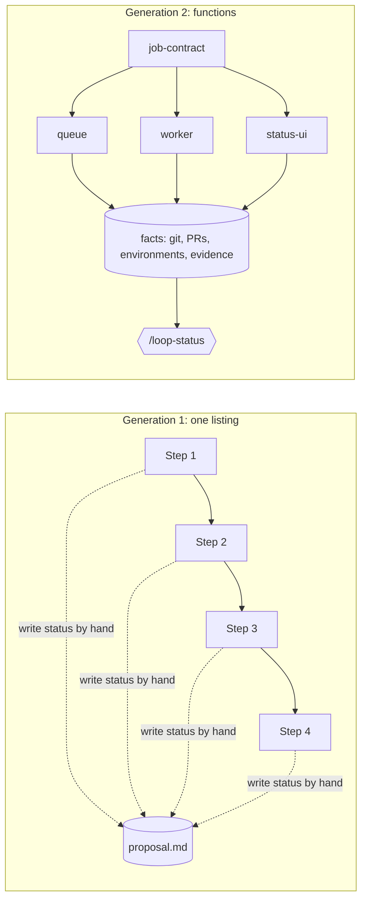
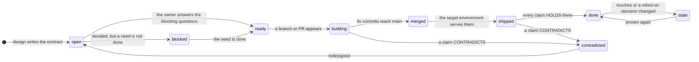
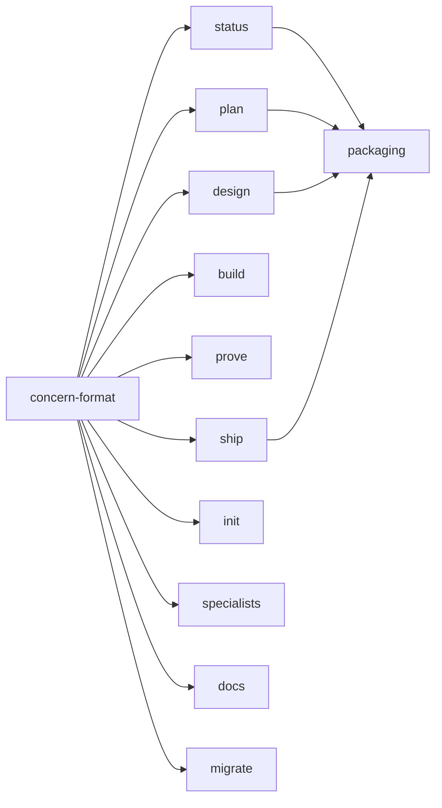

# Proposal: Run each concern as an independent function, and derive its status from facts

**Status:** In progress — 2026-10-17. D1–D4 decided; every concern in §11 is being built on `feat/generation-2`.
Written from a read of every file in `skills/` and `docs/` at `32528da` (generation 1), and from the owner's
account of two weeks of heavy use.
**Area:** `skills/`, `docs/`, `README.md`, `.claude-plugin/`, `scripts/`, `tests/`
**Revisions:** 2026-10-17: recorded D1–D4. `/loop-plan` stays a separate skill (D1), loops live in `docs/loops/`
(D2), agents merge loop-document PRs themselves, and those PRs only record what is on `main` (D3), and a
migration script ships with `/loop-init` (D4). Concern-local decisions became private (P3), and the concern's
sections became Done when, Design, Decisions, Questions, Evidence and Shipped.

## 0. Summary

Generation 1 is written like a GW-BASIC listing. Work is a numbered list of steps in one shared proposal, and
every skill writes its progress into that file by hand. That holds up for one stream of work. With parallel
agents it fails in two places. Parallel branches contend for the same file, and stored status lines drift
from reality until nobody can tell whether a step is done.

**Recommendation:** in generation 2, numbered steps become named **concerns**, and each concern is treated
as a function. A concern is a small file with a contract: what it promises (**done when**), what it **needs**,
what it **touches**, which **effects** (gates) it crosses, and where it **ships to**. Each concern runs its own
design → build → prove → ship lifecycle in its own worktree, in parallel with the others. Status is never
written down. `/loop-status` computes it from git, pull requests, what each environment serves, and SHA-bound
evidence, then says what to run next. The vocabulary shrinks from eleven skills to five verbs (plan, design,
build, prove, ship) plus `status` (per D1).

In one line: *generation 1 asks every agent to be disciplined about shared mutable state; generation 2 removes
the shared mutable state.*

**Decided** (§8): `/loop-plan` adds loops to a backlog and `/loop-design` grills the owner on how one gets built
(D1); the skills track `docs/loops/`, and `docs/proposals/` belongs to people (D2); agents merge PRs that change
only loop documents, and those documents only ever record what is on `main` (D3); `/loop-init` ships a
migration script for generation 1 projects (D4).



## 1. Where we actually are (required)

### 1.1 What generation 1 got right, and keeps

- The human holds every effect that cannot be undone: merging, deploying, money, identity, legal text,
  secrets (`LOOP.md` §2).
- The evidence ladder and the three verdicts, HOLDS / CONTRADICTS / UNPROVEN (`loop-prove`).
- Decisions are numbered and dated, and are superseded rather than edited (`loop-decide`).
- The repository is the shared brain. No chat session carries state.
- Corrections are first-class commits. Runbooks record procedures as they were actually run, and memory facts
  carry dates.
- Commit subjects state outcomes, and each PR carries one intent.

These hold up in practice, and generation 2 keeps all of them. What it changes is where state lives and who
writes it.

### 1.2 What heavy use showed

After a couple of weeks of intense use, the owner reported three things:

1. **Much of a plan could run in parallel.** Separate agents in separate worktrees could have built many of the
   steps at once, but numbered steps in one shared proposal assume a single stream of work.
2. **It was often unclear whether something was already done.** The written status could not be trusted
   without checking it against the code and the environments.
3. **Reconcile and record were what answered that.** Yet they ran as clean-up after the fact, not as the way to
   find out where things stand.

All three follow from how generation 1 is built:

- **Progress is written twice.** Seven skills write progress into the proposal: a step is claimed, built, merged,
  on an environment, done. Every one of those facts is already in git, the pull requests or the environment, so
  each costs a docs commit and the written copy drifts whenever a write is missed.
- **A stored summary goes stale first.** A Status line summarises many of those facts in one sentence, so it is
  the first thing to drift, and correcting it means re-checking all of them.
- **Position stands in for dependency.** Steps are ordered by position, even when the real dependencies are few
  and written in prose ("after Step 4"). Inserting work without renumbering produces `2a`, `2b` and `Step 0`.
- **A recorded "merged" is not proof.** A stacked pull request whose base was never retargeted can merge into
  another branch, where nothing deploys, while the host reports it as merged. Only checking whether the commits
  are on `main` tells the truth, and nothing in generation 1 makes that check routine.

### 1.3 The GW-BASIC diagnosis

| GW-BASIC trait | Where it shows in generation 1 | What it costs |
| --- | --- | --- |
| Line numbers | Plan `Step n`; "Put risky or uncertain work first" ([loop-frame:66](https://github.com/jugonzal/architect-loop/blob/32528daa1e284e107b3e7f41d6114618d986a19f/skills/loop-frame/SKILL.md#L66)) | Position implies order, so parallel work has to be argued for. Inserting work produces `2a`, `Step 0` |
| Global variables | Seven skills write into one proposal. Build's first commit sets "the step's Status in the proposal to `in progress on <branch>`" ([loop-build:34](https://github.com/jugonzal/architect-loop/blob/32528daa1e284e107b3e7f41d6114618d986a19f/skills/loop-build/SKILL.md#L34)) | Parallel branches edit the same file, and every claim is a docs commit |
| `PEEK`/`POKE` to fixed addresses | "required sections stay, even if empty, because other loop skills write into them" ([loop-frame:75](https://github.com/jugonzal/architect-loop/blob/32528daa1e284e107b3e7f41d6114618d986a19f/skills/loop-frame/SKILL.md#L75)); `§11`, `§2.1` | Skills are coupled through section numbers rather than names |
| Flags nobody recomputes | The Status line and the step-status chain ([LOOP.md:96](https://github.com/jugonzal/architect-loop/blob/32528daa1e284e107b3e7f41d6114618d986a19f/skills/loop-init/templates/LOOP.md#L96)); "Status lines go stale" ([loop-reconcile:12](https://github.com/jugonzal/architect-loop/blob/32528daa1e284e107b3e7f41d6114618d986a19f/skills/loop-reconcile/SKILL.md#L12)); "Verify before you write" ([loop-record:39](https://github.com/jugonzal/architect-loop/blob/32528daa1e284e107b3e7f41d6114618d986a19f/skills/loop-record/SKILL.md#L39)) | The guardrail is discipline: every writer must re-verify, and a write that never happens stays wrong |
| `GOTO` | Each skill ends by handing off to the next by name ([loop-prove:70–72](https://github.com/jugonzal/architect-loop/blob/32528daa1e284e107b3e7f41d6114618d986a19f/skills/loop-prove/SKILL.md#L70-L72)) | Control flow is spread across eleven skills' prose, and the owner has to remember where they are |
| `ON ERROR GOTO 10` | On CONTRADICTS, "the work goes back to Frame" for the whole proposal | One failed step reopens a plan that other branches are still building from |
| One global numbering | `D#`/`Q#`/`G#` per proposal; "Never renumber" ([loop-decide:48](https://github.com/jugonzal/architect-loop/blob/32528daa1e284e107b3e7f41d6114618d986a19f/skills/loop-decide/SKILL.md#L48)) | Two parallel branches can each add a `D5` |
| The program is one listing | One proposal per initiative, growing with every step, decision and proof | An agent reads all of it to build one step |

[method.md:78](https://github.com/jugonzal/architect-loop/blob/32528daa1e284e107b3e7f41d6114618d986a19f/docs/method.md#L78) states the design premise: "The proposal is the coordination point". Generation 2
moves the coordination point to the repository's facts, which `/loop-status` reads.

## 2. First principles (required)

Every principle below is a well-known programming idea applied to the loop. Together they amount to one
meta-rule: **prefer structure to discipline.** When a failure keeps needing a guardrail, change the shape of
the system so the failure cannot be written down at all.

### P1. A concern is a function

A concern is named, never numbered. It has a signature:

- **done when**: its return value, a set of falsifiable claims `C1, C2, …`
- **needs**: its arguments, the other concerns that must be done first
- **touches**: its scope, the paths it may change
- **effects**: its side effects, the gates it crosses
- **ships to**: the environment where its claims must hold

Its body is design → build → prove → ship. Any session can call it by name. A loop is a concern made of
concerns, so the same verbs work at every scale.

*From:* functions and composition; Dijkstra's separation of concerns.
*Rule:* the slug and title state the outcome. If "done when" needs an "and", or more than three claims, split
the concern.

### P2. Independent by default, with declared dependencies on contracts

Concerns run in parallel unless one names another in `needs`. Order is a fact you state, not a side effect of
where something sits in a list. When two concerns would share an interface, extract the interface into its own
small concern, decide it first, and make both depend on it. Two concerns with overlapping `touches` have a
dependency that nobody declared. Design catches it before any branch exists.

*From:* dataflow and `make`'s dependency graph; dependency inversion (depend on interfaces, not implementations).
*Rule:* design checks every pair of concerns for overlapping `touches`. Each overlap is resolved with a `needs`,
with a contract concern, or by merging the two concerns.

The same holds between loops, which several can be tracked at once without all being worked on (per D1).
`/loop-plan` compares a new loop with every other loop and records each relation with the loosest coupling
that works, in the new loop's README only:

| Coupling | Meaning | Written as |
| --- | --- | --- |
| relates | Awareness only: a shared area, with no ordering | A line under Relations |
| needs a decision | A concern relies on another loop's published decision, an immutable value | `needs: [billing/D3]` |
| needs a concern | A concern waits for another loop's concern to be done | `needs: [billing/invoices]` |

Anything tighter is forbidden: two loops sharing a concern, a loop editing another loop's files, or needing
another concern's private decisions. That is the structured-design coupling scale. Data coupling on published
values is the loosest, and content coupling (reaching into another module's internals) is the worst.

### P3. Local state, and immutable shared values

Each concern owns its file and its `touches`. An agent working on a concern writes only there. It never edits
the loop's README or another concern's file. Shared decisions live in the loop's README and become immutable
once any concern relies on them. To change one, supersede it with a new decision, and every concern that relied
on the old one shows as stale. IDs are namespaced (`queue/D2`), so parallel branches cannot collide. A
concern's own decisions are private. No other concern may need them, and a decision others must rely on is
published in the loop's README.

*From:* lexical scope, immutability, ownership (one writer per region), information hiding.
*Rule:* one file per concern, and nobody edits a file they do not own.

### P4. Compute status; record only what cannot be recomputed

There are no Status lines anywhere. A concern's state is a function of facts: branches, PRs, commits on `main`,
what each environment serves, and the concern's evidence lines. `/loop-status` evaluates it fresh every time,
so it cannot be stale. It is also *level-triggered*: if someone deploys without running a skill, nothing is
lost, because the next status reads the current state of the world instead of relying on events having been
recorded. The only things recorded are facts no command can re-observe: the owner's decisions, the results of
proofs that are expensive or impossible to replay (a real device, a production observation, a measurement),
and lessons.

The same property makes every command idempotent. Each one starts by evaluating status, so any fresh session
can resume any concern, and running a command twice does no harm.

*From:* referential transparency; normalisation (never store a derived value); Kubernetes-style reconciliation of
desired against observed state; "make illegal states unrepresentable".
*Rule:* if a command can answer it, do not write it down.

### P5. Evidence is a value bound to its inputs

Every verdict names its claim, commit, environment and rung. When code under the concern's `touches` changes
after the proof, or a decision the proof relied on is superseded, the proof becomes stale automatically, like a
cache entry whose key has changed.

*From:* memoisation; content addressing; build systems that rebuild only what changed.
*Rule:* an evidence line without a commit and an environment is not evidence.

### P6. Effects at the edges

Design, build and local proof are pure. Agents run them freely and in parallel, and their output can be thrown
away. Merging, deploying, migrations, money, identity, secrets and messages to users are effects. A concern
declares its effects in its contract up front, so the owner sees every gate before work starts, and a ship brief
can be assembled from the declared effects of the concerns in the batch.

*From:* "functional core, imperative shell"; effect types.
*Rule:* no concern performs an effect its contract does not declare. Effects belong to the owner unless
`LOOP.md` §2.1 delegates them.

### P7. Failure is local and explicit

CONTRADICTS sends that one concern back to design, and its siblings carry on. A contradiction escalates to the
loop only if it falsifies something other concerns rely on, such as a shared decision or a loop-level
assumption. When it does, it escalates as a question, not as a rewrite. Unknown is a value of its own:
UNPROVEN says what is missing and who can supply it, and it never counts as passing.

*From:* result types; errors handled at the function boundary; supervision, with the owner as the supervisor.
*Rule:* verdicts are HOLDS, CONTRADICTS or UNPROVEN, and only what is shared escalates.

## 3. The model (required)

### 3.1 Files

```text
LOOP.md                          the contract: gates, environments, commands (same role as today)
docs/loops/<loop>/README.md      the loop: intent, goals, relations, shared decisions, loop-level questions
docs/loops/<loop>/<concern>.md   one concern: contract, design, decisions, evidence, what shipped
docs/proposals/                  for people: free-form proposals, and abandoned or deprecated loops (not tracked)
docs/runbooks/, docs/memory/     unchanged
```

A loop's concerns are the other files in its folder. The README does not list them, so adding a concern never
edits a shared file. On GitHub, the folder's file list sits right above its README. The skills track every
folder under `docs/loops/` and nothing else. Moving a loop to `docs/proposals/` abandons it (per D2).

**Loop documents only ever describe `main`** (per D3). A code PR never changes `docs/loops/`, and a
loop-document PR changes nothing else. Proof from before the merge lives in the code PR's body, where the
reviewer reads it. Every evidence line in a loop document cites a commit already on `main` (a spike's answer
may cite a branch). Because of that rule, agents may merge loop-document PRs themselves: `LOOP.md` §2.1 carries
the delegation by default, and loop-status's `check_loop_pr.sh` checks every condition before an agent merges.

### 3.2 A concern

The smallest valid concern is what `/loop-plan` writes first:

```markdown
---
needs: [job-contract]
touches: [api/reports/queue*, db/migrations/*report*]
effects: [migration on shared data]
ships-to: production
---
# Report jobs survive a worker restart

## Done when
- **C1** A job enqueued before the worker is killed completes after it restarts. Prove on staging.
- **C2** Enqueueing adds under 5 ms at p95 to the request. Prove on staging, at least 200 samples.
```

As the concern runs, it grows these sections, each with a single writer:

```markdown
## Design              where we are (verified / assumed / missing), options, the approach   (design)
## Decisions           | D1 | Postgres SKIP LOCKED, not Redis | owner, 2026-10-17 | Q1 |    (design, with the owner)
## Questions           | Q2 | … | blocks C2 | default … |                                   (design)
## Evidence            append-only; every line cites a commit on main                      (prove, ship)
- 2026-10-20 · ship · verified · staging @9f3c2e1 · version endpoint, worker logs clean
- 2026-10-21 · C1 · HOLDS · rung 1 · staging @9f3c2e1 · 3 real restarts during the deploy, 0 jobs lost
## Shipped             what shipped, where it departs from the design, what was learned     (status, once done)
```

A concern has no Status line, no step status and no "in progress on <branch>". Status is computed from the
facts, and a claim is visible because the branch exists.

Code links back to concerns through a branch named `<loop>/<concern>` and a `Concern: <loop>/<concern>` trailer
on every commit. The trailer is repeated in the PR body so that squash merges keep it.

### 3.3 The lifecycle, and how status derives it

States are computed from facts, never set. `/loop-status` checks the rows from top to bottom, and the first row
that matches wins:

| State | When (facts) | Next |
| --- | --- | --- |
| parked | A decision in the concern parks or drops it | none; the decision says what would unpark it |
| contradicted | A claim's latest verdict is CONTRADICTS, and no decision has been recorded since | `/loop-design` (or `/loop-diagnose` when the cause is unknown) |
| open | A blocking `Q#` is unanswered | The owner answers it in `/loop-design` |
| blocked | A concern in `needs` is not done | That concern's next action |
| ready | No branch, no PR, and no commit carries its `Concern:` trailer | `/loop-build` |
| building | A branch or PR exists, but none of its commits is on `main` | Build. The owner merges once local proof HOLDS and CI is green |
| merged | Its commits are on `main`, and its `ships-to` environment does not serve them | Prove on any lower environment that serves them, then the owner ships |
| shipped | `ships-to` serves its commits, and some claim has no current HOLDS there | `/loop-prove <concern> <env>` |
| stale | Every claim held there, but code under `touches` or a relied-on decision has changed since | `/loop-prove` again |
| done | Every claim has a current HOLDS on `ships-to` | Status offers to write the Shipped note if it is missing |

Each fact is a read-only command:

- *On `main`*: `git merge-base --is-ancestor <sha> main`.
- *Served by an environment*: the version command in `LOOP.md` §3 returns a SHA that has the concern's
  commits as ancestors.
- *Current* (for a proof): the proof's SHA is an ancestor of the served SHA, and
  `git log <proof-sha>..<served> -- <touches>` prints nothing.



The arrows show facts changing. Nobody records a transition.

A loop's state is derived the same way. It is **parked** if its README names a parking decision, **backlog**
while none of its concerns has a decision, a branch, a PR or evidence (per D1: planned, not yet worked on),
**done** when every concern is done and every `G#` has a current HOLDS, and **active** otherwise. Status puts
active loops first, so a growing backlog never takes the focus off the current work.

### 3.4 What `/loop-status` shows

```text
/loop-status report-pipeline

report-pipeline · 4 concerns · main 9f3c2e1 · staging serves 9f3c2e1 · production serves 4b1a0d7 · 2026-10-21 14:02

concern        state         evidence                                                   next
job-contract   done          C1 HOLDS rung 5, main @7a1e0c2                             —
queue          merged        staging serves it; C1 HOLDS rung 1 @9f3c2e1; C2 UNPROVEN   /loop-prove queue staging
worker         contradicted  C2 CONTRADICTS rung 1 @9f3c2e1: p95 41 s, needs ≤ 30 s     /loop-design worker
status-ui      building      PR #46 draft; its body: C1 HOLDS rung 3 (2 commits behind) /loop-build status-ui

Needs you (2), most unblocking first
  1. worker C2 failed on staging: redesign, or roll staging back. Your call.
  2. queue declares "migration on shared data": it ships to production only by your hand.

Agents can start now (2)
  /loop-prove report-pipeline/queue staging
  /loop-build report-pipeline/status-ui

Drift (1)
  docs/runbooks/reports.md step 4 says reports render inline; main @9f3c2e1 removed api/reports/render_inline.py

Record (1), on your yes
  job-contract is done and has no Shipped note.
```

Status runs only read-only commands: git, `gh`, and the version and verify commands in `LOOP.md` §3 for the
environments agents may read. It never reruns an expensive proof; it says "re-prove" instead. When code under a
concern's `touches` has changed but no evidence covers it, status reads the code and reports what it infers at
rung 6 ("C1 may already hold; prove it"). It writes only after the owner says yes: Shipped notes and loop
corrections go in a loop-document PR that it merges itself (per D3), and memory facts, runbook traps and other
corrections go in a separate PR for the owner. That covers everything `loop-record` and `loop-reconcile` did,
minus the status lines, which no longer exist.

"Needs you" is the owner's queue. One architect running many agents is short of attention, not hands, so
status gathers every open question, pending merge, pending ship and every piece of reality only the owner can
supply, and sorts them by how many concerns each one unblocks.

## 4. The skills (required)

```text
One file:    a concern = done when + needs + touches + effects + ships-to
Five verbs:  plan a loop; then design → build → prove → ship each concern, in parallel with the others
One habit:   /loop-status tells you what is true and what to run next
```

### 4.1 Commands

| Command | Scope | Does | Writes |
| --- | --- | --- | --- |
| `/loop-status [loop[/concern]]` | anything | Derives state, the owner's queue, next actions and drift | Nothing until the owner approves a record |
| `/loop-plan <intent>` | new loop | Captures the intent, goals and a first cut of concerns, compares them with every other loop and with `docs/proposals/`, and records relations at the loosest coupling that works. It is quick, so a new idea never derails the current loop | The new loop's README and one minimal file per concern |
| `/loop-design <loop>` | loop | Grills the owner on the loop's open decisions and the constraints that reading the code turned up. Splits, merges or extracts concerns, publishes shared decisions, and checks `touches` for overlap within the loop and against active loops | The loop's README and its concerns' contracts |
| `/loop-design <loop>/<concern>` | concern | Where we are, options, a recommendation and `Q#`s, then grills the owner one question at a time and records each `D#` | That concern's file |
| `/loop-build <loop>/<concern>` | concern | Worktree, branch, tests first, a PR carrying the `Concern:` trailer and the proof from before the merge | Code inside `touches`, never `docs/loops/` |
| `/loop-build <loop> --ready` | loop | One agent per `ready` concern, each in its own worktree | The same, in parallel |
| `/loop-prove <loop>/<concern> [env]` | concern | The strongest evidence available and a SHA-bound verdict. Also runs spikes that answer a `Q#` | Before the merge, the PR. After it, evidence lines, in a loop-document PR it merges itself |
| `/loop-ship <env>` | environment | A brief for every merged concern the environment does not serve yet, with manual steps taken from their declared effects. Stops for the owner, then verifies | A `ship` evidence line per concern, in the same way |

You also need `/loop-init` once per project, which upgrades a generation 1 project too (D4), and three
specialists that any verb can call: `/loop-diagnose`, `/loop-runbook` and `/loop-incident`. The output of
`/loop-incident` is a new loop of concerns.

`plan` and `design` keep the boundaries of the skills they replace. They plan and never implement (from
`loop-frame`), and they never answer a question on the owner's behalf (from `loop-decide`). Plan asks only what
it needs to capture the intent; design is where the owner gets grilled. Several concerns can be designed in
parallel, one agent each, and the owner then answers all the gathered questions in one sitting from "Needs you".

### 4.2 Generation 1 to generation 2

| Generation 1 | Generation 2 | What changes |
| --- | --- | --- |
| `loop-init` | `loop-init` | `LOOP.md` §3 must give a command that returns each environment's served SHA. §6 loses the Status table and the step-status chain, and gains the concern conventions. §2.1 carries the loop-document delegation. Upgrades generation 1 projects with `migrate_gen1.py` |
| `loop-frame` | `loop-plan` | Lists concerns instead of numbered steps, and records relations to the other loops |
| `loop-decide` | `loop-design` | Grills the owner on a loop's or a concern's open decisions and new constraints; status gathers open `Q#`s across all concerns |
| `loop-build` | `loop-build` | One worktree per concern, the `Concern:` trailer, no claim commits and no status writes. Stops if the work has to leave `touches` |
| `loop-prove` | `loop-prove` | SHA-bound evidence lines. CONTRADICTS sends back one concern, not the whole loop |
| `loop-promote` | `loop-ship` | Works per environment, and assembles the brief from declared effects |
| `loop-record` | `loop-status`, record half | Nothing left to update; writes Shipped notes, corrections and memory on the owner's yes |
| `loop-reconcile` | `loop-status`, observe half | Runs any time, at any scope |
| `loop-diagnose`, `loop-runbook`, `loop-incident` | unchanged | Refer to concerns instead of steps and `§11` |

### 4.3 Who writes what

| | Loop README | Concern contract and design | Code in `touches` | Evidence lines | Shipped note, corrections, memory |
| --- | --- | --- | --- | --- | --- |
| plan | ✓ (new loop) | ✓ (minimal) | | | |
| design | ✓ | ✓ | | | |
| build | | | ✓ | | |
| prove | | | test harnesses only | ✓ (after the merge) | |
| ship | | | | ✓ (`ship` lines) | |
| status | | | | | ✓ after the owner's yes |

Within one concern, each cell has one writer at a time, and code and loop documents never share a PR. That is
why parallel worktrees merge without conflicts.

## 5. Parallel work, end to end (required)

1. `/loop-plan move report generation off the request path` writes `docs/loops/report-pipeline/` with three
   concerns, and notes one relation: `billing` relates, because both touch `api/reports/`.
2. `/loop-design report-pipeline` grills the owner. The overlap check finds that `queue` and `worker` both
   touch `api/reports/jobs.py`, so the job schema is extracted into `job-contract`, which both of them need.
   `status-ui` needs it too. Four agents then draft the concern designs in parallel, `/loop-status` gathers
   their five open questions, and the owner answers them in one sitting.
3. `job-contract` ships to `main` (its claims are tests), so it is done as soon as it is merged and proven.
4. `/loop-build report-pipeline --ready` starts three agents in three worktrees, producing three branches and
   three PRs. None of them edits a shared file.
5. The owner merges each PR when it is ready. `/loop-ship staging` writes a brief that lists `queue`'s declared
   migration as a manual step for the owner.
6. On staging, `worker`'s C2 fails. Status shows `worker` as contradicted and sends it back to design.
   `queue` and `status-ui` carry on (the board in §3.4).

## 6. Options

| | A. Patch generation 1 | B. Concerns and derived status | C. B plus a status CLI |
| --- | --- | --- | --- |
| What | Namespaced IDs and one file per step, with stored status kept | This proposal | The same model, with a script that computes the facts deterministically |
| Parallel conflicts | Fixed | Fixed | Fixed |
| "Is it done?" | Still a stored answer that goes stale | Computed every time | Computed, and reproducible |
| Install | None | None | A script, which costs the zero-install property |
| Learn | Eleven skills | Five verbs and `status` | The same, plus a tool |

Also rejected: one file per loop with the concerns as sections, because parallel branches would contend for one
file again; and evidence in `git notes`, which suits P5 well but is invisible on GitHub and needs explicit refspecs.

## 7. Recommendation (required)

**B.** It removes both problems the owner hit, contention between parallel agents and not knowing whether
something is done, by construction rather than by discipline. It keeps every invariant generation 1 earned,
and a newcomer has to learn one file format, five verbs and one habit. The derivation table in §3.3 is precise
enough to become option C's script later, if two status runs on the same facts ever disagree.

## 8. Decisions (required)

| # | Decision | Decided by, date | Notes |
| --- | --- | --- | --- |
| D1 | `/loop-plan` is its own skill. It adds big items to a backlog of loops that can be tracked side by side without being worked on at once, compares each new loop with the loops in progress, and leaves dependency observations at the loosest coupling possible. `/loop-design` clarifies how a loop will be implemented by grilling the architect on open decisions and new constraints. | owner, 2026-10-17 | Closes Q1. Five verbs; loop states `backlog` and `active` (§3.3); coupling scale (P2) |
| D2 | `docs/loops/` holds the loops the skills track. `docs/proposals/` is left to people, and to loops that were deprecated or abandoned. | owner, 2026-10-17 | Closes Q2. Moving a loop to `docs/proposals/` abandons it |
| D3 | Agents have an implicit permission to push PRs that update loop documents and nothing else, to make things faster for the architect. Loop documents are updated only after the evidence is merged into `main`. | owner, 2026-10-17 | Closes Q3. Read as: the agent opens such a PR and merges it itself, as a default row in `LOOP.md` §2.1 the owner can delete. Code PRs never touch `docs/loops/`; pre-merge proof lives in the code PR; `check_loop_pr.sh` checks paths, the base branch, and that every cited commit is on `main` |
| D4 | Generation 2 includes a script that migrates projects that started on generation 1. | owner, 2026-10-17 | `skills/loop-init/scripts/migrate_gen1.py`, run by `/loop-init` in upgrade mode |

## 9. Open questions (required)

| # | Question | Blocks | Default if unanswered |
| --- | --- | --- | --- |
| ~~Q1~~ | ~~Is planning a new loop `/loop-design <intent>`, or a separate `/loop-plan`?~~ → D1 | | |
| ~~Q2~~ | ~~Do loops live in `docs/loops/<loop>/`, or in `docs/proposals/<loop>/`?~~ → D2 | | |
| ~~Q3~~ | ~~After a merge, how do evidence lines and Shipped notes reach `main`?~~ → D3 | | |

## 10. Defaults this plan assumes, veto any (required)

- `loop-promote` becomes `loop-ship`. The old names stay as one-line alias skills for one release.
- Commits link to concerns through the branch `<loop>/<concern>` and a `Concern:` trailer, repeated in the PR body.
- `touches` may name another repository (`site:html/`), and status reads that repository's PRs and merges in the
  same way, for concerns that change a second repository.
- A concern's claims are numbered `C#`, and a loop's goals keep `G#`. In generation 1, `G#` meant both goals
  and gates; in generation 2, gates live in `effects`.
- No CLI for status. The derivation table lives in `loop-status/SKILL.md`. The two scripts that do ship are
  mechanical guards: `check_loop_pr.sh` (D3) and `migrate_gen1.py` (D4).
- `loop-diagnose` stays a separate specialist rather than becoming a mode of `loop-prove`.
- Migration (per D4): finished, superseded and parked generation 1 proposals stay in `docs/proposals/` as history.
  Proposed, accepted and in-progress ones become loops. Unfinished steps become concerns, done steps stay in
  the history file, and `D#`/`Q#`/`G#` keep their numbers in the loop's README. The script is a dry run until
  told otherwise, and never edits `LOOP.md`, which `/loop-init` upgrades with the owner.
- The plugin version becomes 0.2.0.

## 11. Plan, as concerns (required)

This plan uses the format it proposes. `concern-format` is the contract every other concern needs. Once it is
decided, the eight concerns that need nothing else can run in parallel, one worktree each. All of them ship to
`main`, and none crosses a gate except `packaging`, whose release is the owner's to publish.



| Concern | Done when | Touches | Needs |
| --- | --- | --- | --- |
| `concern-format` | **C1** The minimal concern is at most ten lines, and the full template fits on one screen. **C2** Applying §3.3 by hand to the §5 walkthrough yields the states shown in §3.4 | `skills/loop-plan/templates/`, `skills/loop-init/templates/LOOP.md` | — |
| `status` | **C1** On a fixture repository with one concern in each of the ten states, it derives all ten. **C2** Two runs with nothing changed in between print the same board and write nothing. **C3** `check_loop_pr.sh` refuses a PR that touches anything outside `docs/loops/`, or that cites a commit not on `main` | `skills/loop-status/` | `concern-format` |
| `plan` | **C1** Given an intent that overlaps a loop in progress, it records the relation at the loosest coupling that works, and edits no other loop | `skills/loop-plan/`, removes `loop-frame/` | `concern-format` |
| `design` | **C1** Given the §5 loop, it finds the `queue`/`worker` overlap and resolves it. **C2** It asks blocking `Q#`s one at a time and records each `D#` where it belongs: shared in the README, private in the concern | `skills/loop-design/`, removes `loop-decide/` | `concern-format` |
| `build` | **C1** Two concerns built at the same time in two worktrees merge with no conflict under `docs/`. **C2** No build commit changes a file outside its concern's `touches` | `skills/loop-build/` | `concern-format` |
| `prove` | **C1** Every verdict it writes names a claim, a SHA, an environment and a rung. **C2** Status shows the proof as stale after a commit to `touches` | `skills/loop-prove/` | `concern-format` |
| `ship` | **C1** The brief lists every declared effect of every concern in the batch. **C2** After the deploy, it checks the served SHA | `skills/loop-ship/` (from `loop-promote/`) | `concern-format` |
| `init` | **C1** The `LOOP.md` template has no Status table and asks for each environment's served-SHA command. **C2** On a generation 1 project, it runs the migration as a dry run, shows it, and applies it only on the owner's yes | `skills/loop-init/SKILL.md` | `concern-format` |
| `specialists` | **C1** `diagnose`, `runbook` and `incident` refer to concerns, never to steps or `§11` | `skills/loop-diagnose/`, `skills/loop-runbook/`, `skills/loop-incident/` | `concern-format` |
| `docs` | **C1** The README teaches `status` and the five verbs on one screen. **C2** `method.md` is built on the seven principles | `README.md`, `docs/` | `concern-format` |
| `migrate` | **C1** On a generation 1 repository, a dry run lists every proposal and step with its classification and reason, and writes nothing. **C2** `--apply` turns every in-progress proposal into a loop whose unfinished steps are concerns and whose `D#`/`Q#`/`G#` keep their numbers. **C3** A second `--apply` changes nothing | `skills/loop-init/scripts/`, `tests/` | `concern-format` |
| `packaging` | **C1** `scripts/check.sh` passes, runs the migration tests, and fails on any live skill that refers to a retired one. **C2** `plugin.json` says 0.2.0 | `.claude-plugin/`, `scripts/`, `.github/` | `status`, `plan`, `design`, `ship` |

`migrate` lives under `loop-init`, whose `touches` (`skills/loop-init/`) would overlap with `init`'s. The
overlap is resolved by narrowing: `init` owns `SKILL.md` and `templates/`, and `migrate` owns `scripts/`. That is
P2 working as intended.

**The loop is done when** the next initiative on a real project runs as a generation 2 loop with at least three concerns
built in parallel worktrees, and the owner never has to ask whether a concern is done. This is rung 1: the real
project, with real work.

## 12. What shipped, and where it departs from this text (required)

2026-10-17, on `feat/generation-2`, not yet merged:

- **Skills.** `loop-status` (with `scripts/check_loop_pr.sh`), `loop-plan` (with the loop and concern templates),
  `loop-design`, `loop-build`, `loop-prove`, `loop-ship`, and `loop-init` (the generation 2 `LOOP.md`, plus
  `scripts/migrate_gen1.py`). `loop-diagnose`, `loop-runbook` and `loop-incident` were updated. The five
  retired names are stubs.
- **Docs.** README, `method.md` (on the seven principles), `patterns.md` (an eleventh pattern), `failure-modes.md`,
  `adopting.md`, `openspec-comparison.md`, and a new `upgrading.md`.
- **Checks.** `scripts/check.sh` also checks script links and shell syntax, keeps retired skills as stubs, refuses
  live references to them, and runs `tests/`: 36 tests, 11 for `check_loop_pr.sh` and 25 for the migration.
- **Proof so far.** The tests build synthetic generation 1 repositories with real git history. The dry run
  writes nothing, `--apply` writes the loops and marks the old proposals, and a second `--apply` changes nothing.
  A Status such as "done for the web; the app waits" becomes a concern rather than history, and one where the
  owner accepted the rest as gaps stays done. `check_loop_pr.sh` lets through only what D3 allows. Not yet proven:
  the skills themselves on a real loop, which is the loop-level goal above.

Where it departs from this text:

- §3.3: `open` (for an incomplete contract) and `blocked` apply only before anything is built. A built concern's
  contract gaps are drift, so the board never hides progress. A loop with no concerns is `open`. A loop stays in
  the backlog while none of its *concerns* has a decision or work, so shared decisions recorded during planning
  do not activate it.
- P5: a CONTRADICTS line counts even without a commit, because a contradiction is a reason to stop wherever it was
  seen. A line marked `@?` never counts as a HOLDS.
- Drift reports overlapping `touches` only between concerns not yet merged, since merged ones cannot collide.
- §3.2: the concern's design sections are Where we are, Options and Approach, under one Design heading. A `ship`
  line uses `<env> @<sha>` like every other evidence line.

## Sources, as read 2026-10-16

- This repository at [`32528da`](https://github.com/jugonzal/architect-loop/tree/32528daa1e284e107b3e7f41d6114618d986a19f)
  (generation 1): `skills/*/SKILL.md`, their templates, `docs/*.md`
- The owner's account of two weeks of heavy use, 2026-10-16
